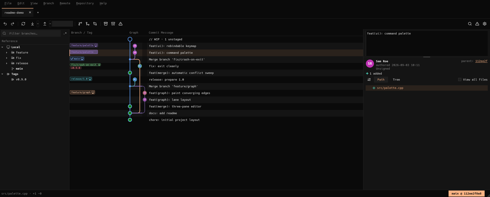

<p align="center">
  
</p>

<h1 align="center">GitMycelium</h1>

<p align="center">
  A fast, native Git client for large repositories.<br>
  C++20 · Qt 6 · libgit2 — no Electron, no web view, no telemetry.
</p>

<p align="center">
  <a href="LICENSE"></a>
  
  
</p>

<p align="center">
  
</p>

GitMycelium is a desktop Git client built for repositories where most GUI clients
start to struggle: a million commits, thousands of branches, a working tree of a
hundred thousand files. It puts two things first: **resolving merge conflicts** and
**managing branches**.

- **Fast on big repositories.** History is paged, the commit graph is laid out
  incrementally, and git's commit-graph file is read directly. The window opens on
  a million-commit repository without loading the whole history.
- **Uses git the way git does.** Local reads go through libgit2. Anything with side
  effects goes through the `git` binary you already have, so your hooks, signing,
  credential helpers, LFS, `.gitattributes` filters and merge drivers all keep
  working.
- **Keyboard-first and terminal-styled.** A command palette, rebindable shortcuts, a
  monospace dark theme (a light theme is also available) and zoom.

## Download

Prebuilt binaries are on the [Releases](https://github.com/ndeana-21/GitMycelium/releases) page:

- **Linux x86_64**: an AppImage that runs on distributions with glibc 2.35 or newer.
  Run `chmod +x GitMycelium-*.AppImage`, then start the file.
- **macOS (Apple Silicon, macOS 12 or newer)**: a `.dmg` with the app.

`git` 2.38 or newer must be installed. To build from source, see below.

### Opening the app on macOS

The app is signed ad-hoc and not notarized by Apple, so the first launch shows
*"Apple could not verify that GitMycelium is free of malware"*. On macOS 15 and later
right-click → **Open** no longer gets past this. Allow it once:

1. Drag **GitMycelium** from the `.dmg` to **Applications** and open it. When the
   warning appears, click **Done**.
2. Open **System Settings → Privacy & Security** and scroll down to *Security*.
3. Next to *"GitMycelium was blocked…"*, click **Open Anyway** and confirm with your
   password or Touch ID.

After that it opens normally. Alternatively, remove the quarantine flag in Terminal:

```bash
xattr -dr com.apple.quarantine /Applications/GitMycelium.app
```

Repeat this after installing a new download.

## Contents

- [Download](#download)
- [Features](#features)
- [Requirements](#requirements)
- [Building on Linux](#building-on-linux)
- [Building on macOS](#building-on-macos)
- [Running](#running)
- [Installing and packaging](#installing-and-packaging)
- [Headless mode](#headless-mode)
- [Project layout](#project-layout)
- [Changelog](CHANGELOG.md)
- [Contributing](#contributing)
- [License](#license)
- [Trademarks and affiliation](#trademarks-and-affiliation)

## Features

### Commit graph

- The history of **all** refs (branches, remote-tracking branches, tags, stashes) in
  git's own `--topo-order`. Pages are loaded as you scroll.
- One colour per branch. A branch's line and its label share the colour, merges
  draw as converging curves, and each node shows the author's initials.
- Branch labels group a local branch with its remote-tracking twin and show
  ahead/behind arrows. Overflowing labels collapse into `+N` and expand on hover.
- Hovering a branch highlights its commits and dims the rest.
- Drag a branch onto another branch to merge, rebase or check out, or onto a commit
  to create a branch there, move the branch or check out a detached HEAD.
- A working-tree (`// WIP`) node for the current checkout and for every dirty linked
  worktree.
- Search by message, author or hash, and keyboard navigation to parent and child.
- Branch visibility: hide branches, solo branches, presets, and *Focus on Current
  Branch*, which shows only the current branch, its target and their upstreams.
- Resizable, reorderable columns (labels, graph, message, author, date, hash) and
  optional timeline separators.

### Merge conflicts

- A three-pane editor (**Ours | Base | Theirs**) above an editable **Result**. The
  common ancestor is always shown (diff3).
- Take ours, base, theirs or both for each conflict or for the whole file, pick
  individual lines, or edit the result by hand. Changed words are highlighted
  inside each side.
- An **automatic pass** settles the trivial cases (identical sides, one side equal
  to the base, whitespace-only differences, non-overlapping changes) and leaves
  anything ambiguous for you to decide.
- **Conflict prediction before you merge or rebase** (`git merge-tree`), run locally
  and without touching your working tree.
- Binary conflicts, delete/modify conflicts, rerere (reuse recorded resolution),
  "mark as conflicted again", and your configured external merge tool.
- One page for every open operation, whether it is a merge, rebase, cherry-pick,
  revert, squash or a conflicting `stash pop`. Each can be continued, completed or
  aborted, including operations started by another client.

### Branches and history

- Create, rename, delete (also in bulk), check out, track an upstream, fast-forward,
  move a branch, pin branches, and group branches into folders.
- Merge (fast-forward, no-ff or squash), rebase, cherry-pick and revert.
- **Interactive rebase editor**: reorder, squash, fixup, reword or drop commits,
  including the root commit.
- **Undo/redo** of ref-moving operations through an operation log.
- Tags (create, delete, push), reflog viewer, file history (`--follow`), blame, and
  compare any two commits (two-dot or three-dot).

### Working tree and commits

- Stage and unstage files, hunks or **single lines**. Discard hunks or lines.
- Commit, amend, sign (GPG or SSH, via git), co-author trailers, commit templates,
  and "push after commit".
- Stash: push, apply, pop, drop, and create a branch from a stash.
- Apply patches (`git apply` for plain diffs, `git am` for mailboxes) and add paths
  to `.gitignore` or `info/exclude`.

### Diff viewer

- Unified and side-by-side views, full-file view, word wrap, a minimap,
  word-level emphasis and syntax highlighting.
- Encoding selection and your configured external diff tool.

### Remotes and repositories

- Clone (shallow, single-branch and partial `--filter=blob:none` clones), fetch,
  fetch all, pull (fast-forward only, merge or rebase), push, and force-with-lease.
- Optional background auto-fetch for each repository.
- Linked **worktrees**, **submodules** (including nested ones), **Git LFS**,
  sparse checkout, and git hooks management.
- Maintenance: `gc`, `fsck`, commit-graph and multi-pack-index writes.
- Several repositories in tabs, a start page with recent repositories, and creating
  a new repository.

### Interface

- Command palette (`Ctrl+P`) with every action, and a rebindable keymap.
- Dark theme by default, a light theme, and UI zoom.
- Per-repository preferences: column layout, branch pins, branch visibility,
  auto-fetch and pre-flight checks.

## Requirements

| | Minimum | Notes |
|:--|:--|:--|
| C++ compiler | C++20 | GCC 11+, Clang 14+, Apple Clang 15+ |
| CMake | 3.21 | |
| Qt | 6 | modules: Core, Gui, Widgets, Svg, Test; tested with 6.8 and 6.11 |
| libgit2 | 1.7 | found through `pkg-config`; developed against 1.9 |
| git | 2.38 | needed at run time; GitMycelium runs it for every network operation and for anything that runs hooks |
| git-lfs | optional | only for repositories that use LFS |

Supported platforms: **Linux x86_64** and **macOS on Apple Silicon (arm64)**. Other
Unix-like systems should work but are not tested.

## Building on Linux

Install the dependencies for your distribution:

```bash
# Debian / Ubuntu
sudo apt install build-essential cmake ninja-build pkg-config git \
                 qt6-base-dev qt6-svg-dev libgit2-dev

# Fedora
sudo dnf install gcc-c++ cmake ninja-build pkgconf-pkg-config git \
                 qt6-qtbase-devel qt6-qtsvg-devel libgit2-devel

# Arch Linux
sudo pacman -S --needed base-devel cmake ninja pkgconf git qt6-base qt6-svg libgit2
```

Ubuntu 24.04 ships Qt 6.4, which is older than the versions we test with. If the
build fails there, install a newer Qt with the [Qt online installer](https://www.qt.io/download-qt-installer-oss)
or [aqtinstall](https://github.com/miurahr/aqtinstall), as CI does, and pass
`-DCMAKE_PREFIX_PATH=/path/to/Qt/6.x/gcc_64` to CMake.

Then configure, build and test:

```bash
git clone https://github.com/ndeana-21/GitMycelium.git
cd GitMycelium

cmake -S . -B build -G Ninja -DCMAKE_BUILD_TYPE=Release
cmake --build build
ctest --test-dir build --output-on-failure   # optional: the full test suite

./build/src/gitmycelium /path/to/a/repository
```

## Building on macOS

Install the Xcode command line tools and [Homebrew](https://brew.sh), then:

```bash
xcode-select --install
brew install cmake ninja pkg-config qt libgit2 git

git clone https://github.com/ndeana-21/GitMycelium.git
cd GitMycelium

cmake -S . -B build -G Ninja -DCMAKE_BUILD_TYPE=Release \
      -DCMAKE_PREFIX_PATH="$(brew --prefix qt)"
cmake --build build
ctest --test-dir build --output-on-failure   # optional

open build/src/GitMycelium.app --args /path/to/a/repository
# or run the binary inside the bundle directly:
./build/src/GitMycelium.app/Contents/MacOS/GitMycelium /path/to/a/repository
```

To build a self-contained `.dmg`, put the Qt frameworks inside the bundle, sign it
ad-hoc (no Apple developer account is needed) and package it:

```bash
macdeployqt build/src/GitMycelium.app
codesign --force --deep --sign - build/src/GitMycelium.app
(cd build && cpack -G DragNDrop)
```

An ad-hoc-signed app is not notarized, so the first launch of a downloaded copy is
blocked; see [Opening the app on macOS](#opening-the-app-on-macos).

## Running

```bash
gitmycelium                       # start page: open, clone or create a repository
gitmycelium /path/to/repository   # open a repository directly
gitmycelium --help                # every command-line option
```

Useful shortcuts: `Ctrl+P` opens the command palette, `Ctrl+O` opens a repository
and `Ctrl+Shift+O` clones one. `Alt+Up` and `Alt+Down` move to the parent and child
commit, and `Ctrl+Home` jumps to the tip of the branch. You can rebind shortcuts in
**Preferences → Keymap**.

Preferences are stored with `QSettings` in the standard location for your platform.
Settings that belong to a repository (rerere, signing, diff and merge tools) are
stored in that repository's git config, so the `git` CLI sees the same values.

## Installing and packaging

On Linux:

```bash
cmake --install build --prefix ~/.local      # binary, .desktop entry and icon
(cd build && cpack)                          # .tar.gz
(cd build && cpack -G DEB)                   # .deb (needs dpkg-deb)
(cd build && cpack -G RPM)                   # .rpm (needs rpmbuild)
```

The install puts `bin/gitmycelium`,
`share/applications/gitmycelium.desktop`, the icon, and the license files under
`share/doc/gitmycelium`.

## Headless mode

Most of the application can run without a display. The test suite and CI use this,
and it is useful for debugging:

```bash
# Dump repository state (refs, graph lanes, conflicts) without a GUI
./build/src/gitmycelium --probe /path/to/repository

# Render the window to a PNG offscreen
QT_QPA_PLATFORM=offscreen ./build/src/gitmycelium --shot ui.png /path/to/repository

# Rebase headlessly and report what happened, including the automatic conflict pass
./build/src/gitmycelium --rebase-onto main --sweep /path/to/repository
```

> **Note:** most `--ui-*` diagnostic flags carry out real operations such as
> committing, rebasing or pushing. Run them on a throwaway clone, not on a
> repository you care about.

`scripts/demo-playground.sh` builds a disposable set of repositories under
`~/gitmycelium-demo` for trying things out by hand, and `scripts/make-big-repo.sh`
generates a large synthetic repository for performance work.

## Project layout

```
src/core    domain types, conflict and diff algorithms (no Qt)
src/git     libgit2 wrappers and typed `git` subprocesses (no Qt)
src/repo    RepoSession, the only gateway to git state, plus the undo log
src/graph   commit-graph lane layout (no Qt)
src/theme   palette, fonts, icons
src/model   Qt item models
src/ui      widgets and the graph painter
src/app     main()
tests/      Qt Test suites, each against real temporary repositories
bench/      performance benchmark
docs/       design notes
```

The core and git layers do not depend on Qt, so they can be tested on their own.
The GUI thread never runs a git operation. [AGENTS.md](AGENTS.md) records the
architecture rules and a long list of known pitfalls. Read it before changing
anything substantial.

## Contributing

Bug reports and pull requests are welcome. See [CONTRIBUTING.md](CONTRIBUTING.md).
In short: keep the build warning-free, add a test against a real repository for any
behaviour change in the git layer, and run `ctest` before sending a change.

## License

GitMycelium is licensed under the **Apache License, Version 2.0**. See
[LICENSE](LICENSE) and [NOTICE](NOTICE).

It uses third-party components under their own licenses. Qt is LGPLv3 (linked
dynamically), libgit2 is GPLv2 with a linking exception, and the Lucide icons are
ISC. See [THIRD_PARTY_NOTICES.md](THIRD_PARTY_NOTICES.md) for the full list and
what each license requires when you redistribute binaries.

The software is provided "as is", without warranties of any kind. A Git client can
rewrite history and discard uncommitted work when you ask it to, so keep backups of
anything you cannot afford to lose.

## Trademarks and affiliation

GitMycelium is an independent open-source project. It is not affiliated with,
endorsed by, or sponsored by any company that makes Git clients or Git hosting.
"Git" and the Git logo are trademarks of Software Freedom Conservancy. Qt is a
trademark of The Qt Company Ltd. GitHub, GitLab, macOS and other names are
trademarks of their respective owners and are used here only to refer to their
products.
